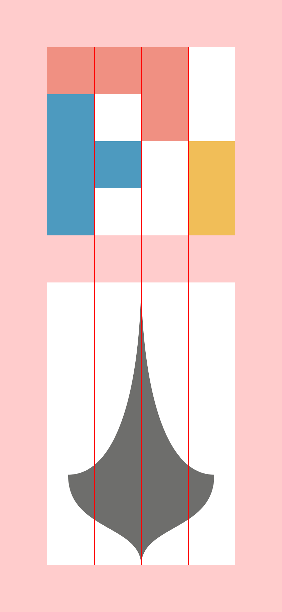

# Brand guidelines

These guidelines explain how to refer to Earendil and Pi and how to use the logos in this kit. For a use not covered here, contact [brand@earendil.com](mailto:brand@earendil.com) with a description or visual mockup.

## Names and relationship

**Earendil** is the company. **Pi** is Earendil's agent harness and coding agent. Use the Earendil name and logo when referring to the company; use the Pi name and logo when referring to the product. Write the names as **Earendil** and **Pi** in prose.

## Choosing a logo

- **Symbol + wordmark (`logo-wordmark-horizontal/`, `logo-wordmark-stacked/`):** Preferred when introducing the company or product, or when its name should be immediately clear. Use the stacked lockup where the horizontal one does not fit.
- **Symbol alone (`logo/`):** Use in compact spaces, such as an app icon, avatar, or favicon, or alongside other brands' symbols when the brand is clear from context.

Use the supplied artwork as a complete asset. Do not separate the lettering from a lockup, change its proportions, or rebuild it in another typeface. Do not create new lockups.

## Color and backgrounds

Prefer the standard logos in `on-light/` and `on-dark/`. Choose the version intended for the background and ensure it remains clearly visible.

Use `monochrome-on-light/` or `monochrome-on-dark/` when a one-color treatment is necessary, such as for single-ink printing, engraving, or a layout that requires all logos to be monochrome.

Use the colors already present in the supplied artwork; do not recolor the marks.

## Clear space

The Pi symbol is built on a four-by-four grid. The Earendil symbol is centered within a frame of the same width, even though its visible shape is narrower. **One grid unit is one-quarter of that shared symbol frame's width.**

Leave at least **one grid unit of clear space around the supplied logo asset**. This applies to both symbol-only logos and the Earendil symbol + wordmark lockup; measure from the outer edge of the entire asset, not just the symbol.

## Size and integrity

Use a size at which the symbol remains recognizable and the Earendil wordmark, when used, remains legible. If the Earendil lockup becomes too small to read, use its symbol alone where the surrounding context identifies it. Do not stretch, rotate, crop, add effects to, rearrange, or redraw the artwork.

## Third-party use

You may use the names and unmodified supplied logos to accurately identify or discuss Earendil or Pi. Do not suggest sponsorship, endorsement, or an affiliation that does not exist; make your own brand clearly distinct. Do not incorporate our names or logos into the name or logo of your own product or organization.

For co-branding, merchandise, or any use that could imply an official relationship, contact [brand@earendil.com](mailto:brand@earendil.com) before publishing. These guidelines do not change any rights you may have in software or other materials; permission to use software does not by itself grant permission to use a brand as your own.

## Files in this kit

Each brand folder contains its logos as SVG and PNG, `print/` vector PDFs in CMYK for coated (PSO Coated v3) and uncoated (PSO Uncoated v3) paper, `favicons/` for websites and apps, `social/` profile pictures, and `email-signature/` images.
